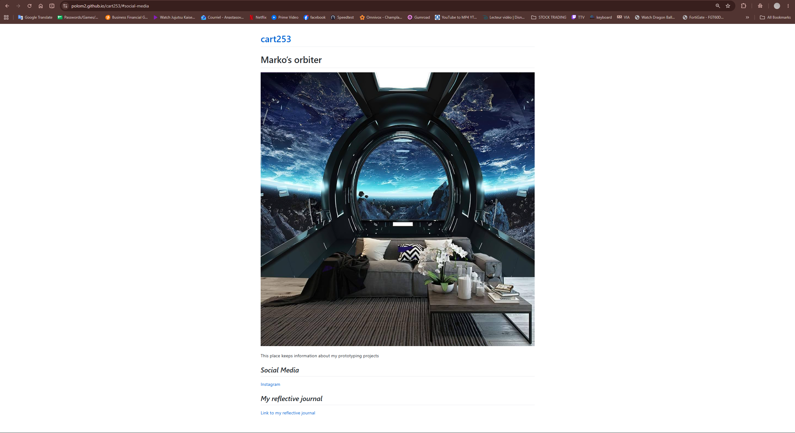

# Reflective Journal 1

## 15 September 2026

    While making my website with Markdown and GitHub, I was surprised that the website was coming to life from my README.md file. I thought I would have to code a lot more or do something more complicated. It was actually simpler than I expected.

    I learned how Markdown works and how important syntax is. Small mistakes with symbols or file pathways can change how things appear on the website. I think it is cool that something as simple as a Markdown file can create a website, but there is still so much more I can learn and improve.

    The most difficult part was understanding file pathways and how GitHub connects with VS Code. I also found committing and pushing confusing at first. I had to understand why pushing changes is important and how it keeps my work updated. The GitHub Pages settings were also a little difficult to understand.

    This project made me want to learn more about coding and web design. I feel genuinely excited because I can see myself making my website more creative and personal in the future. I hope people who visit my website feel curious about my work and get a better idea of me as an artist and creator. My aspiration is to keep learning and eventually make websites that are more interactive and unique.

    Marko

    

# Reflective Journal 2

 ## 22 September 2026

    I learned a lot more about coding while working on my prototypes. The variables challenge was definitely tougher when I wanted to make things more “spicy” and add more interesting effects. It made me understand better how variables can control different parts of a project.

    Making multiple prototypes also helped me deepen my skillset and understand JavaScript a bit more, especially JS draws and functions. Each prototype gave me a chance to try something different and learn from what did not work.

    I faced a lot of problems and setbacks while working, but the troubleshooting actually helped me understand the principles and syntax better. Instead of just following instructions, I had to figure out why something was not working and find a way to fix it. This helped me remember the code better.

    I also learned more about WebGL and how code can create visual and interactive results. I think it is cool that a few lines of code can completely change what happens on the screen. Seeing my prototypes improve through each version made me more interested in coding.

    For the future, I want to keep experimenting with JavaScript, WebGL, and interactive projects. I want to become more comfortable with coding so I can create more complex ideas without being stuck every time something does not work.

    Marko

# Reflective Journal 3

## 29 September 2026

    I learned more about coding through my prototypes, especially syntax and variables. I also learned how to add images using different let variables and functions.

    There was definitely a lot of frustration when things did not work, but troubleshooting helped me understand the code better. It was sometimes annoying, but figuring out the problems made it worth it.

    Overall, I learned a lot more about JavaScript and how different functions work together. It was challenging but also fun to see my ideas actually work on screen.

    Marko

 # Reflective Journal 4

 ## 6 october 2026

    I learned more about conditionals and how text can be added to my prototypes. I learned how to use text functions to add instructions and small details to the screen, like the “STASH THE CASH!” header and the face on the character. It made my prototypes feel more complete and interactive.

    I also learned more about how different parts of the code work together. Using variables, functions, and conditionals can make the prototype react and change depending on what is happening. It was still confusing at times, but I am getting better at understanding what each part of the code is doing.

    Another thing I learned was how to properly use the right file paths for links to my code and online drawings. I had some problems with paths before, so understanding how to connect everything properly made things easier.

    Overall, I am slowly becoming more comfortable with JavaScript and making interactive drawings. I still have a lot to learn, but troubleshooting and experimenting with different ideas is helping me understand the code better.

    Marko
  # Reflective Journal 5

## 13 october 2026

    I learned more about conditionals and how to add text to my prototypes. Adding instructions like “STASH THE CASH!” and giving my character a face made the project feel more complete and gave it more personality. I realized that even small details can help communicate an idea and make an interactive drawing more interesting.

    I also experimented with variables to change colors and make the background change over time. At first, understanding how variables, functions, and conditionals work together was confusing, but I am slowly getting better at connecting them. This is helping me become more independent when I want to experiment with an idea instead of only following examples.

    Another thing I learned was how to use the correct file paths for links to my code and online drawings. I had problems with this before, but troubleshooting helped me understand why the correct syntax and organization matter.

    I think these projects are helping me grow as both a student and an artist. I am learning to be more patient when things do not work and to see mistakes as part of the process. Coding also gives me another way to express my ideas, because I can make visuals react, change, and communicate something to the viewer. I still have a lot to learn, but I feel more confident experimenting and finding solutions on my own.

    Marko

    ## October 20 2026
# Reflective Journal 6

## 27 October 2026

I learned a lot more about functions while working on my three prototypes. I started understanding how parameters and return values work, especially when making multiple objects behave in similar ways. For my Protect the Human prototype, I learned how to make enemies spawn continuously and bounce off walls and the paddle without creating each one manually.

One of the more difficult parts was understanding symbols like <=, >=, ||, and *=. I also had problems with my collision code because I placed it outside the function. Troubleshooting helped me understand why code placement and syntax are important.

For my Moodz prototype, I experimented with return values and conditionals to randomly change a character's expression using shapes and colors. I liked how something simple could become more expressive through interaction.
I worked on Rainbowballz, where I experimented with random colors, bouncing balls, and a circle following the mouse. I learned that the order of code matters because my background was covering the circle.

Overall, these prototypes helped me understand functions better and become more independent with JavaScript. I still struggle sometimes, but I feel more confident experimenting with my ideas.

Marko
# Refectlive Journal 7
## 3 November 2026

## Journal Entry – Arrays

For this assignment, I worked on three different prototypes using arrays. I wanted to take some of the ideas from my previous projects and experiment with them in different ways.

For my first prototype, I reused the bouncing balls idea from an earlier project. This time, I experimented with making the balls interact with each other. I wanted one ball to spread its colour to the others when they collided. This helped me understand how arrays can store multiple objects and how I can use loops to check interactions between them.

For my second prototype, I created a character that displays different messages when the spacebar is pressed. I used an array to store the messages and `random()` to select one each time. I liked this idea because it was simple but gave the character a bit of personality. It also helped me understand how to access specific elements inside an array using an index.

For my third prototype, I wanted to experiment with sound. I created MemeBOX, which was supposed to play a random sound effect whenever the mouse is pressed. I used an array to store the sounds and tried using `loadSound()` to load them into the project. Unfortunately, I ran into problems getting the audio to play. It was frustrating because I spent quite some time checking the file paths and trying to figure out what was wrong, but I couldn't get it working. I look forward to fixing it another time.

Overall, I found arrays useful because they let me organize multiple elements and interact with them without having to create separate variables for everything. I also noticed that combining arrays with things I already learned, like functions, loops and events, opens up more possibilities for my prototypes. I still need more practice, but I feel like I understand their purpose better now.

# Final Reflective Journal Part 1
## 14 November 2026

### Planning and brianstorm

As I begin planning and brainstorming for my final prototype, my main goal is to bring together everything I have learned both inside and outside of class into one cohesive project. Looking back at my earlier journals, I can see how much my understanding of JavaScript has grown since I started with basic Markdown pages and simple variables, eventually moving on to conditionals, custom functions, collision logic, and arrays.
For this final project, I want to combine these foundational tools with new techniques while also tackling the challenges that gave me trouble before. One of my top technical priorities is finally fixing and mastering loadSound(), building on the audio experiments from my last prototype so I can properly implement sound effects alongside a dedicated background music theme. Adding responsive audio will make the experience feel much more alive and polished, especially when paired with the interactive visuals, custom text, and dynamic color changes I practiced in projects like Protect the Human, Moodz, and Rainbowballz. Before jumping straight into writing complex code, however, I am starting with the basics of visual planning by establishing a clear design direction, choosing a cohesive color palette, and putting together a moodboard. Rather than just building a generic, simple minigame, I want my prototype to have a recurring theme and a meaningful message behind it, because throughout this semester I have realized that small artistic details—like giving a character a distinct expression or crafting thoughtful on-screen text—are what truly communicate an idea and connect with the viewer. By anchoring my code in a strong concept from day one, I hope to create something that reflects my growth as both a coder and an artist. At the same time, my biggest challenge during this planning phase is managing my ambition, as I have been told that I tend to overcomplicate my ideas and reach too far given the short amount of time we have left. With my other classes also nearing the end of the semester, my schedule is getting tight, and I know I cannot afford to get stuck troubleshooting overly complex systems at the last minute. 
To stay on track, I am going to rely on the iterative approach that helped me in earlier assignments by starting with a clean, working core prototype first. Once the basic mechanics, file pathways, and sound functions are working properly, I can gradually layer in extra polish and "spicy" details if time allows. By balancing creative ambition with realistic planning, I feel confident that I can finish the semester with an interactive project I am genuinely proud of. I'm also thinking of making it a thing where a family member is the inspiration or loved one, i have already done a bunch of things for my partner, so I could maybe do one inspired my sister's or mom's imagination i nterms of theme.

Marko

# Final Reflective Journal Part 2
## TBD November 2026

### Mid completion
For this project, I wanted to build a larger-scale prototype with a broader theme than my previous ones, giving me the chance to explore plenty of ideas I had in the past. The genesis of the project came from browsing nature art on Pinterest, where I saved pictures of trees and nature views and slowly put together a story just by looking at them. The experience starts with a scenery of bushes and trees. Clicking on the bushes takes you to another view of a tall tree, and clicking on this tree takes you to the Rooted Tree, where little animals lie and sleep within the roots. You can click on them to awaken them and unlock dialogue, then optionally go back and click on another animal for more wisdom. Adding the back button made it feel like a mystery game where you have to go back and find clues, and I plan to style it later and maybe add more for the other scenes.
To bring this together, I borrowed previous code from my older prototypes, including the custom mouse cursor, functions, arrays, let variables, conditionals, and text instructions. Speaking of the close-ups of the animals, I realized it was simpler and unavoidable to just create functions that draw the scenes and load them. I set let scene = 1 at the start so it always opens on the bushes, and created a bushArea object with x, y, width, and height properties. When the mouse overlaps that area and mousePressed is valid, it changes scene to 2.
There was definitely some trouble with the overlap and hover mechanics at first, but troubleshooting helped me finally understand the full logic behind how mouse hovering over an object works. I also touched up the first scene and made lots of adjustments to get it right. Another problem I had to solve was moving around the den and the text. Constantly playing with coordinates to align them each time was not efficient enough, so I made two variables using math to calculate the center of the den area by dividing the width by two, and adding 40 to the height so the banner sits right underneath. This makes me wonder how I can use this logic on a larger scale for bigger concepts, though for now I am planning on using it to make all the dens in a much easier fashion.
So far, I am mostly proud of how objects highlight when hovering over them, how the text appears with a background box behind it, and how I added sets of scenes drawn depending on what the mouse presses on. For my analysis and next steps, I want the project to be immersive with carefully picked soundtracks and sound effects. I failed to get loadSound working in my third arrays prototype, so I am trying to accomplish that now and learn how to successfully implement audio into this project.
Marko

# Final Reflective Journal Part 3
## TBD November 2026

### Post Completion
As I get closer to finishing my final prototype, I have been focusing on bringing the experience together through sound, dialogue, and smaller details that make the world feel more alive. One of my biggest goals was finally getting the music and sound effects working, especially after struggling with loadSound() in my previous prototypes. I had to reattempt the audio several times, checking my file paths, HTML, and sound functions. At first, the music would only play after the first mouse press, which was frustrating because I wanted it to start automatically. Eventually, I managed to get it working, and even though it might seem like a small accomplishment, I was genuinely happy because I had been confused about this for so long.

I also started adding sound effects for the animals, particularly the bear. This came with a few problems of its own. The bear wasn't making sounds when clicked because I had forgotten to check that the scene was equal to 4, which is the close-up scene. I also had a small mistake when copying my else if statements. Troubleshooting these issues helped me better understand how my conditionals and mousePressed() functions work together.
Another big step was successfully implementing dialogue for the animals. I used arrays to store the bear's dialogue and made it so each click moves to the next line. I also added a way to return to the previous scene using a back button. Seeing all these functions work together as I originally imagined was really satisfying. I also fixed an issue where one of my dens was not appearing because the hover-text banner was being drawn over it.
At this point, I want to focus on the finishing touches and the overall message of the story. I have been thinking about adding more dialogue in the earlier scenes to give hints about the story's meaning. I want to explore the idea of someone who starts off disconnected from nature and technology, but gradually becomes more rooted in the natural world through exploration and interaction. I also have some extra ideas, like hidden stars that could lead to a secret animal feast, although I need to be realistic with the time I have left.

Overall, this project has pushed me to use almost everything I learned throughout the semester, from variables and conditionals to arrays, functions, sound, and scene management. I am proud of how much I managed to bring together, especially considering how many problems I had to troubleshoot along the way. It has made me more confident in experimenting with code and combining programming with storytelling and visual design.

Marko

ORIGINAL NOTE ----MAKE MESSAGES IN EARLIER SCENES TO PUSH STORY LORE
"you started by rooted to technology (hinted by you wearing headphones, and the bear mentions you look different then before), there could be a button that says click to remove headphones at the beginning to fix the non-immersiveness of having the soundtrack pplay only when the first mouse click is pressed, and the more you explore nature the more you become ROOTED. ----

ALSO WOULD LIEK TO ADD LITTLE STARS IN THE FIRST SCENE WITH THE TREE ----> BC ONE OF THE ANIMALS WILL HINT AT THEM WITH A RIDDLE EX: " the place where the stars shine bright, the one that sits closest to the EAST will show you the way to the FEAST" and when you hover over the little star thats closest to the RIGHT OR EAST, you will be brought to a special scene where the animals are having a feast.