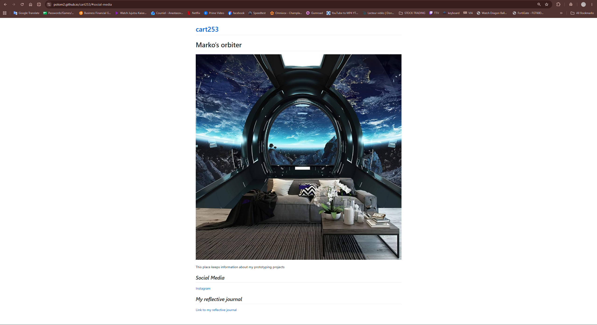

    # Reflective Journal 1

    ## 15 September 2026

    While making my website with Markdown and GitHub, I was surprised that the website was coming to life from my README.md file. I thought I would have to code a lot more or do something more complicated. It was actually simpler than I expected.

    I learned how Markdown works and how important syntax is. Small mistakes with symbols or file pathways can change how things appear on the website. I think it is cool that something as simple as a Markdown file can create a website, but there is still so much more I can learn and improve.

    The most difficult part was understanding file pathways and how GitHub connects with VS Code. I also found committing and pushing confusing at first. I had to understand why pushing changes is important and how it keeps my work updated. The GitHub Pages settings were also a little difficult to understand.

    This project made me want to learn more about coding and web design. I feel genuinely excited because I can see myself making my website more creative and personal in the future. I hope people who visit my website feel curious about my work and get a better idea of me as an artist and creator. My aspiration is to keep learning and eventually make websites that are more interactive and unique.

    Marko

    

    # Reflective Journal 2

    ## 22 September 2026

    I learned a lot more about coding while working on my prototypes. The variables challenge was definitely tougher when I wanted to make things more “spicy” and add more interesting effects. It made me understand better how variables can control different parts of a project.

    Making multiple prototypes also helped me deepen my skillset and understand JavaScript a bit more, especially JS draws and functions. Each prototype gave me a chance to try something different and learn from what did not work.

    I faced a lot of problems and setbacks while working, but the troubleshooting actually helped me understand the principles and syntax better. Instead of just following instructions, I had to figure out why something was not working and find a way to fix it. This helped me remember the code better.

    I also learned more about WebGL and how code can create visual and interactive results. I think it is cool that a few lines of code can completely change what happens on the screen. Seeing my prototypes improve through each version made me more interested in coding.

    For the future, I want to keep experimenting with JavaScript, WebGL, and interactive projects. I want to become more comfortable with coding so I can create more complex ideas without being stuck every time something does not work.

    Marko

    # Reflective Journal 3

    ## 29 September 2026

    I learned more about coding through my prototypes, especially syntax and variables. I also learned how to add images using different let variables and functions.

    There was definitely a lot of frustration when things did not work, but troubleshooting helped me understand the code better. It was sometimes annoying, but figuring out the problems made it worth it.

    Overall, I learned a lot more about JavaScript and how different functions work together. It was challenging but also fun to see my ideas actually work on screen.

    Marko

    # Reflective Journal 4

    ## 6 october 2026

    I learned more about conditionals and how text can be added to my prototypes. I learned how to use text functions to add instructions and small details to the screen, like the “STASH THE CASH!” header and the face on the character. It made my prototypes feel more complete and interactive.

    I also learned more about how different parts of the code work together. Using variables, functions, and conditionals can make the prototype react and change depending on what is happening. It was still confusing at times, but I am getting better at understanding what each part of the code is doing.

    Another thing I learned was how to properly use the right file paths for links to my code and online drawings. I had some problems with paths before, so understanding how to connect everything properly made things easier.

    Overall, I am slowly becoming more comfortable with JavaScript and making interactive drawings. I still have a lot to learn, but troubleshooting and experimenting with different ideas is helping me understand the code better.

    Marko

    # Reflective Journal 5

    ## 13 october 2026

    I learned more about conditionals and how to add text to my prototypes. Adding instructions like “STASH THE CASH!” and giving my character a face made the project feel more complete and gave it more personality. I realized that even small details can help communicate an idea and make an interactive drawing more interesting.

    I also experimented with variables to change colors and make the background change over time. At first, understanding how variables, functions, and conditionals work together was confusing, but I am slowly getting better at connecting them. This is helping me become more independent when I want to experiment with an idea instead of only following examples.

    Another thing I learned was how to use the correct file paths for links to my code and online drawings. I had problems with this before, but troubleshooting helped me understand why the correct syntax and organization matter.

    I think these projects are helping me grow as both a student and an artist. I am learning to be more patient when things do not work and to see mistakes as part of the process. Coding also gives me another way to express my ideas, because I can make visuals react, change, and communicate something to the viewer. I still have a lot to learn, but I feel more confident experimenting and finding solutions on my own.

    Marko

    # reflective journal 6

    ## October 27 2026

    # Reflective Journal 6

## 27 October 2026

I learned a lot more about functions while working on my three prototypes. I started understanding how parameters and return values work, especially when making multiple objects behave in similar ways. For my Protect the Human prototype, I learned how to make enemies spawn continuously and bounce off walls and the paddle without creating each one manually.

One of the more difficult parts was understanding symbols like <=, >=, ||, and *=. I also had problems with my collision code because I placed it outside the function. Troubleshooting helped me understand why code placement and syntax are important.

For my Moodz prototype, I experimented with return values and conditionals to randomly change a character's expression using shapes and colors. I liked how something simple could become more expressive through interaction.
I worked on Rainbowballz, where I experimented with random colors, bouncing balls, and a circle following the mouse. I learned that the order of code matters because my background was covering the circle.

Overall, these prototypes helped me understand functions better and become more independent with JavaScript. I still struggle sometimes, but I feel more confident experimenting with my ideas.

Marko

